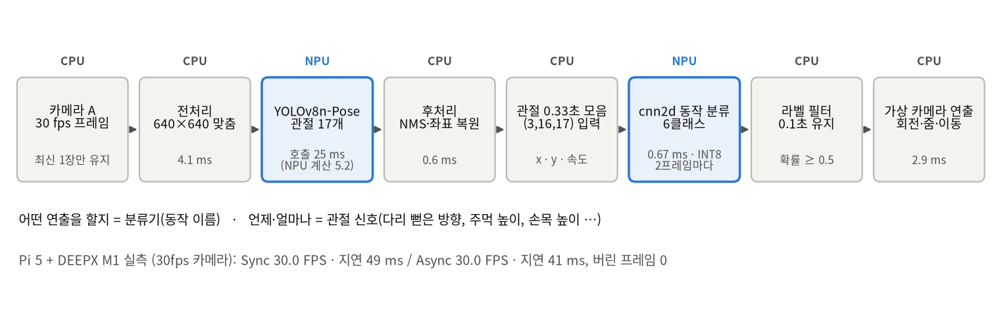
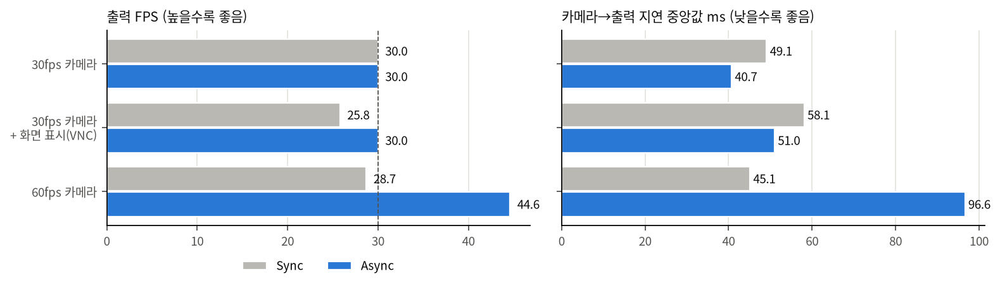
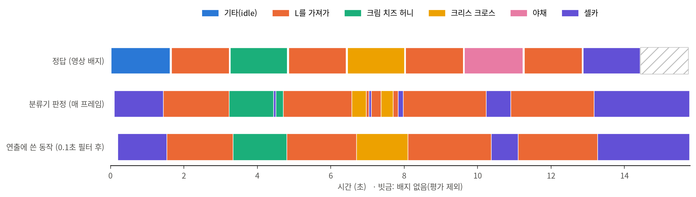

# dance-cam

고정된 폰 카메라 한 대로 춤을 찍으면, 동작에 맞춰 화면을 기울이고 확대하고 따라가는 가상 카메라.
Raspberry Pi 5 + DEEPX M1 NPU에서 실시간(30 FPS)으로 돈다.

온디바이스 AI 기말 프로젝트 5조 — 김민석(보드·앱), 이찬용(데이터·모델·컴파일)



## 구조

```
카메라 → letterbox 640×640 → YOLOv8n-Pose (.dxnn, NPU) → 관절 17개
      → 최근 0.33초 관절을 (3,16,17)로 변환 → cnn2d (.dxnn, NPU) → 동작 6개 확률
      → 라벨 필터 (0.5 이상, 0.1초 유지) → 동작별 가상 카메라 (CPU) → FPS 표시·저장·화면
```

- 포즈 모델은 DEEPX 제공 YOLOv8n-Pose를 그대로 쓰고, 동작 분류기(cnn2d, 파라미터 9.4만, .dxnn 0.125 MB)만 학습했다.
- 어떤 연출을 할지는 분류기가 정하고, 언제·얼마나는 관절 좌표가 정한다 (예: L를 가져가 → 뻗은 다리 쪽으로 최대 15° 기울임).

## 폴더

| 경로 | 내용 |
|---|---|
| `pi_live.py` | Pi 실시간 실행 (Sync / Async, FPS 표시, 프레임별 기록) |
| `pc_preview.py` | PC에서 ONNX로 같은 연출을 미리 보기 |
| `dancecam/keypoints.py` | 관절 창 → (3,16,17) 입력. 골반 원점, 몸통 길이로 나눔, x·y·속도, 0~255 |
| `dancecam/models.py` | cnn2d (tcn, resnet18은 비교용) |
| `dancecam/pose.py` | 포즈: PC는 Ultralytics, Pi는 `DxPose` (dx_app 전처리·후처리 재사용) |
| `dancecam/classifier.py` | 0.33초 버퍼, 2프레임마다 분류 (.onnx / .dxnn 둘 다) |
| `dancecam/effects.py` | 가상 카메라 (회전·확대·이동, 모서리 안 보이게 자동 확대) |
| `dancecam/overlay.py` | 디버그 영상 그리기 |
| `presets/effects.json` | 동작 이름 → 연출 종류와 값 |
| `tools/` | 관절 추출, 학습, ONNX·DX-COM 컴파일, INT8 비교, 평가, 디버그 영상 |
| `models/` | 학습된 cnn2d (`.pt`, `.onnx`, `.dxnn`, 라벨 순서, 학습·평가 결과) |
| `data/raw/*.segments.csv` | 구간 라벨 (영상 파일은 저작권 때문에 올리지 않음) |

## 새 영상으로 학습하기

### 1. 영상과 라벨

영상을 `data/raw/`에 넣고, 같은 이름으로 `.segments.csv`를 만든다.

```
data/raw/my_dance.mp4
data/raw/my_dance.segments.csv
```

```csv
start_s,end_s,label
0.00,1.63,idle
1.65,3.24,L_gajyeoga
3.25,4.82,cream_cheese_honey
```

- 시간은 초 단위. 구간 경계에 걸친 창은 학습에서 자동으로 빠진다.
- 동작이 아닌 부분(인트로, 쉬는 동작)은 `idle`로 넣는다. 없으면 인트로에서 아무 연출이나 켜진다.
- 라벨 이름은 자유. 새 이름을 쓰면 `presets/effects.json`의 `moves`에도 같은 이름을 추가한다.
- 영상이 여러 개면 전부 `data/raw/`에 넣으면 된다. 여러 사람 영상이 많을수록 일반화가 좋아진다.

### 2. PC (DX-COM 환경)

```bash
PY=python   # 예: ../../dxcom-env/bin/python
pip install -r requirements-pc.txt          # dx_com은 DEEPX 설치 가이드대로 따로 설치

$PY tests/run_tests.py

# 관절 추출 (영상마다 .npz 하나, YOLOv8n-Pose 가중치는 처음 실행 때 자동으로 받음)
$PY tools/extract_keypoints.py data/raw data/kpts

# 학습: 영상 하나면 --split time (구간마다 끝 0.6초를 검증용으로 뗌)
#       영상이 여러 개면 --split video --val-match <검증 영상 이름 일부>
$PY tools/train.py --kpts data/kpts --raw data/raw --model cnn2d --split time --out runs

# ONNX + INT8 컴파일 (보정: 실제 관절 창 100개)
$PY tools/export_compile.py --models cnn2d --weights cnn2d=runs/cnn2d.pt --calib data/kpts --out build
cp runs/cnn2d_labels.json build/

# PC에서 연출 미리 보기
$PY pc_preview.py --video data/raw/my_dance.mp4 --classifier build/cnn2d.onnx \
    --labels build/cnn2d_labels.json --out runs/preview.mp4
```

결과: `build/cnn2d.onnx`, `build/cnn2d_dxnn/cnn2d.dxnn`, `build/cnn2d_labels.json`.
`--window`(기본 0.33초)는 학습, 컴파일, 실행에서 같아야 한다.

### 3. Pi 5 + M1

필요한 것: DXRT, dx_app (`~/dx-all-suite/dx-runtime/dx_app`), YOLOv8n-Pose .dxnn (dx_app 예제 모델 `yolov8-n-pose_640x640.dxnn`).

```bash
source ~/dx-all-suite/dx-runtime/venv-dx-runtime/bin/activate
cd ~/dance-cam
mkdir -p models data runs_pi
# PC에서 복사: build/cnn2d_dxnn/cnn2d.dxnn, build/cnn2d_labels.json, 영상
# 포즈 모델: models/yolov8-n-pose_640x640.dxnn

python3 pi_live.py --src data/my_dance.mp4 --cam-fps 30 --mode async --show \
    --pose models/yolov8-n-pose_640x640.dxnn --clf models/cnn2d.dxnn \
    --labels models/cnn2d_labels.json --out runs_pi/my_dance.mp4
# USB 카메라: --src 0
# VNC 화면에 띄우기: DISPLAY=:0 XAUTHORITY=$HOME/.Xauthority 를 앞에 붙임
```

결과:
- `runs_pi/my_dance.mp4`: FPS 표시가 들어간 출력
- `_report.json`: FPS, 지연, 버린 프레임
- `_frames.npz`: 프레임별 관절·확률·판정

```bash
# 정답 구간과 비교 (동작별 정답률, 전환 지연)
python3 tools/eval_pi_run.py --frames runs_pi/my_dance_frames.npz \
    --segments data/raw/my_dance.segments.csv --cam-fps 30 --out runs_pi/my_dance_eval.json
# 관절·확률을 그린 디버그 영상 (실행 중에 그리면 FPS가 떨어져서 실행 후에 그림)
python3 tools/render_debug.py --src data/my_dance.mp4 --cam-fps 30 \
    --frames runs_pi/my_dance_frames.npz --out runs_pi/my_dance_debug.mp4
```

## 결과 (L을 가져가 트렌드 영상)

**분류기**: 학습 창 730개 (좌우 반전 포함), 검증 정답률 93.4%.

**INT8 양자화** (DX-COM 2.4.1, PTQ, 보정 100개): 전부 NPU 1그룹, CPU 0그룹. 같은 입력 423개에서 FP32와 판단 일치 98.1%, 정답률 92.7% → 91.7%.

**Pi 실시간** (영상을 30fps 카메라처럼 공급):

| 조건 | Sync | Async |
|---|---|---|
| 30fps 입력 | 30.0 FPS, 지연 49.1 ms | 30.0 FPS, 지연 40.7 ms |
| 30fps 입력 + 화면 표시 (VNC) | 25.8 FPS, 61장 버림 | **30.0 FPS, 0장 버림** |
| 60fps 입력 | 28.7 FPS | 44.6 FPS (지연 97 ms) |

**병목**: 포즈 `ie.run()` 호출은 25 ms인데, NPU 순수 계산은 5.2 ms다. 나머지는 입출력 전송(1.2 MB / 1.9 MB)과 런타임 처리 시간이다.
- Sync에서는 이 대기 시간이 병목이다.
- Async로 대기를 겹치면 병목이 CPU 쪽(전처리, 연출, 저장)으로 옮겨 간다.
- 포즈 모델만 여러 장 겹쳐 넣으면 초당 122장까지 처리한다.



**일반화**: 학습에 안 쓴 영상(다른 댄서, 거울 모드)으로 재학습 없이 시험했다. 연출에 쓴 동작의 정답률은 71.6%로, 같은 기준에서 학습 영상은 84.3%였다.
- 잘 맞은 동작: L를 가져가 99%, 크림 치즈 허니 94%, 크리스 크로스 85%, 셀카 75%
- 틀린 동작:
  - 인트로(idle): 얼굴 옆 V 자세라 셀카로 판정됐다.
  - 야채: 동작이 크게 바뀌어 L를 가져가로 판정됐다.
- 원인은 동작마다 한 사람의 예시만 학습한 것이다. 여러 사람 데이터가 필요하다.



## 알려진 문제

- tcn은 컴파일은 되지만 M1에서 실행하면 오류가 난다. 그래서 cnn2d를 쓴다.
- `--show`를 쓰면 종료할 때 Qt 경고가 나오는데, 동작에는 영향이 없다.
